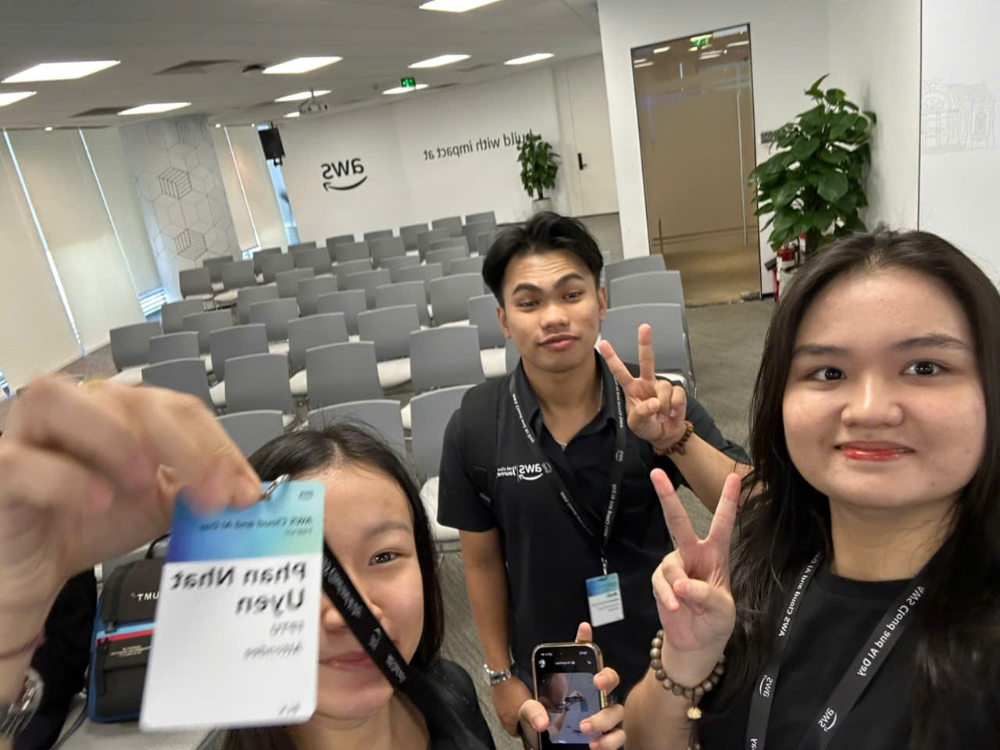

# AWS CLOUD AND AI DAY HANOI 2026

- **Thời gian:** Thứ Ba, ngày 29/09/2026
- **Địa điểm sự kiện chính:** JW Marriott Hotel Hanoi, Hà Nội
- **Hình thức tham gia:** HCMC Watch Party do First Cloud AI Journey (FCAJ) tổ chức tại TP. Hồ Chí Minh
- **Vai trò:** Người tham dự Watch Party

## 1. Giới Thiệu Và Mục Đích Sự Kiện

AWS Cloud and AI Day Hanoi 2026 là sự kiện công nghệ do Amazon Web Services (AWS) tổ chức, tập trung vào điện toán đám mây (Cloud Computing), trí tuệ nhân tạo (AI), phân tích dữ liệu và phát triển ứng dụng hiện đại.

Sự kiện quy tụ nhiều chuyên gia AWS, kỹ sư, kiến trúc sư giải pháp và đại diện doanh nghiệp nhằm chia sẻ kinh nghiệm triển khai hệ thống, giới thiệu các công nghệ mới và những giải pháp đang được áp dụng trong thực tế.

**Mục tiêu chính của chương trình:**

- Cập nhật các xu hướng mới về AWS Cloud và AI.
- Tìm hiểu cách ứng dụng AI vào phát triển phần mềm và tự động hóa.
- Giới thiệu các giải pháp quản lý dữ liệu, bảo mật và tối ưu tài nguyên AWS.
- Chia sẻ kinh nghiệm xây dựng, triển khai và vận hành hệ thống thực tế.
- Tạo cơ hội học hỏi và kết nối với cộng đồng công nghệ.

Em tham gia chương trình thông qua **HCMC Watch Party** do cộng đồng First Cloud AI Journey tổ chức tại TP. Hồ Chí Minh, theo dõi nội dung được phát trực tiếp từ sự kiện chính tại Hà Nội.

## 2. Danh Sách Diễn Giả Keynote

Phần Keynote có sự tham gia của các diễn giả và đại diện đến từ cơ quan quản lý, AWS và các doanh nghiệp.

| Diễn giả | Chức danh |
|---|---|
| Hoàng Minh | Thứ trưởng Bộ Khoa học và Công nghệ |
| Jennifer Wicks | Đại sứ Hoa Kỳ tại Việt Nam |
| Dr. Werner Vogels | Giám đốc Công nghệ (CTO), Amazon.com |
| Eric Yeo | Giám đốc quốc gia AWS phụ trách Malaysia, Việt Nam và khu vực Đông Dương |
| Mai Le | Giám đốc Quản lý Sản phẩm, Katalon |
| Dr. Jens Lottner | Tổng Giám đốc, Techcombank |

Các diễn giả mang đến những góc nhìn về sự phát triển của điện toán đám mây, vai trò của AI trong doanh nghiệp và cách ứng dụng công nghệ để giải quyết những bài toán thực tế.

## 3. Lịch Trình Và Hoạt Động Chính

Sự kiện chính tại Hà Nội diễn ra trong một ngày, bao gồm phần Keynote, các phiên chia sẻ chuyên đề, hoạt động thực hành và giao lưu công nghệ.

| Thời gian | Hoạt động |
|---|---|
| 07:30 | Đăng ký và mở khu triển lãm |
| 09:00 | Keynote – Phiên khai mạc |
| 10:15 | Nghỉ giải lao và giao lưu |
| 11:00 | Các phiên chia sẻ kỹ thuật buổi sáng |
| 12:05 | Nghỉ trưa và tham quan triển lãm |
| 13:10 | Các phiên chuyên đề đầu giờ chiều |
| 14:50 | Nghỉ giải lao |
| 15:20 | Các phiên chuyên đề cuối buổi chiều |
| 17:00 | Kết thúc chương trình |

*Lưu ý: Đây là lịch trình chung của sự kiện chính tại Hà Nội, không phải toàn bộ lịch hoạt động riêng của HCMC Watch Party.*

## 4. Những Nội Dung Nổi Bật Trong Chương Trình

### 4.1. Keynote – What Does It Take to Solve Problems Everyone Says Are Impossible?

- **Mã phiên:** KEY001
- **Thời gian:** 09:00
- **Địa điểm:** Grand Ballroom, Hà Nội

Phần Keynote mở đầu chương trình, tập trung vào cách công nghệ hỗ trợ con người và doanh nghiệp giải quyết những bài toán phức tạp.

**Các chủ đề đáng chú ý:**

- Sử dụng AI Agent để hỗ trợ quá trình phát triển phần mềm.
- Hiện đại hóa hệ thống và ứng dụng trên nền tảng Cloud.
- Xây dựng giải pháp công nghệ có khả năng mở rộng.
- Đảm bảo bảo mật và độ tin cậy khi triển khai hệ thống.

Qua nội dung này, em nhận thấy AI và Cloud Computing không chỉ hỗ trợ tự động hóa mà còn góp phần thay đổi cách xây dựng và vận hành ứng dụng.

### 4.2. Building Software Like Never Before with Agentic AI

- **Mã phiên:** DVT203 / DVT205
- **Thời gian:** 11:00
- **Đơn vị trình bày:** AWS
- **Phiên DVT205:** HCMC Watch Party

Đây là một trong những chủ đề em quan tâm vì liên quan trực tiếp đến lĩnh vực phát triển phần mềm và ứng dụng AI.

Phiên chia sẻ tập trung vào **Agentic AI**, hướng tiếp cận cho phép AI Agent thực hiện những tác vụ có mục tiêu thay vì chỉ phản hồi các câu hỏi đơn giản.

**Nội dung chính:**

- Cách AI Agent hỗ trợ lập trình viên.
- Ứng dụng AI để tự động hóa các tác vụ trong quy trình phát triển phần mềm.
- Khả năng phối hợp giữa AI Agent và con người.
- Những vấn đề cần quan tâm khi đưa AI Agent vào môi trường thực tế.

Em đặc biệt quan tâm đến khả năng sử dụng AI như một công cụ hỗ trợ lập trình, giúp giảm những thao tác lặp lại và dành nhiều thời gian hơn cho việc thiết kế, kiểm tra và cải thiện chất lượng phần mềm.

### 4.3. From Demo to Deployment: Solving Agentic AI's Toughest Challenges

- **Mã phiên:** AIM201
- **Thời gian:** 11:00
- **Đơn vị trình bày:** Katalon, AWS

Phiên này đề cập đến những khó khăn khi chuyển một ứng dụng AI Agent từ bản thử nghiệm sang hệ thống hoạt động thực tế.

**Các vấn đề nổi bật:**

- Đảm bảo AI Agent hoạt động ổn định.
- Đánh giá độ chính xác và độ tin cậy của kết quả.
- Quản lý quyền truy cập và bảo mật dữ liệu.
- Theo dõi và kiểm soát hoạt động của AI Agent.

Từ chủ đề này, em hiểu rằng xây dựng một bản demo AI chỉ là bước đầu. Khi triển khai thực tế, cần quan tâm đến khả năng vận hành, bảo mật và kiểm soát kết quả.

### 4.4. Data Analytics Và Nền Tảng Dữ Liệu Cho AI

**Một số phiên tiêu biểu:**

| Mã phiên | Chủ đề |
|---|---|
| ANT202 | Build an AI-ready Data Foundation |
| ANT201 | Data-Driven AI Agents for FSI |
| ANT205 | Bridge Data Silos with Amazon Quick Suite |
| ANT214 | VPBank's Cloud Journey with Amazon Redshift |

Nhóm nội dung này tập trung vào việc xây dựng và quản lý dữ liệu nhằm phục vụ phân tích và phát triển ứng dụng AI.

**Những điểm đáng chú ý:**

- Chuẩn bị và tổ chức dữ liệu trước khi sử dụng AI.
- Kết nối dữ liệu từ nhiều nguồn khác nhau.
- Ứng dụng Amazon Redshift trong xây dựng nền tảng phân tích dữ liệu.
- Sử dụng Amazon Quick Suite để hỗ trợ khai thác thông tin.

Qua các chủ đề được giới thiệu, em hiểu thêm rằng chất lượng dữ liệu ảnh hưởng trực tiếp đến hiệu quả của hệ thống AI. Việc thu thập, quản lý và kiểm tra dữ liệu là bước quan trọng trước khi triển khai các giải pháp thông minh.

### 4.5. Hiện Đại Hóa Ứng Dụng Và Cloud Infrastructure

**Một số phiên nổi bật:**

| Mã phiên | Chủ đề |
|---|---|
| DEV205 | Internal Developer Platform on Amazon EKS |
| DEV208 | Migrating a NestJS App from EC2 to EKS with GitOps |
| MAM203 | From Monolith to Microservices |
| AIM303 | Modernize SQL Server & .NET with AWS Transform |

Các phiên chia sẻ giới thiệu những phương pháp xây dựng, chuyển đổi và quản lý ứng dụng trên AWS.

**Nội dung chính:**

- Sử dụng Amazon EKS để quản lý các ứng dụng container.
- Chuyển đổi ứng dụng từ kiến trúc Monolith sang Microservices.
- Ứng dụng GitOps để quản lý quy trình triển khai.
- Sử dụng các công cụ AWS để hỗ trợ hiện đại hóa hệ thống.

Những chủ đề này giúp em hình dung rõ hơn cách doanh nghiệp triển khai ứng dụng trên Cloud, cũng như lý do cần lựa chọn kiến trúc phù hợp với quy mô và nhu cầu thực tế.

### 4.6. Cloud Security Và Tối Ưu Chi Phí AWS

**Một số phiên tiêu biểu:**

| Mã phiên | Chủ đề |
|---|---|
| DEV401 | Engineering Workload Identity on AWS |
| DVT305 | AWS Security Agent |
| AIM203 | Defence in Depth for Agentic Workloads |
| DEV204 | Stop Overpaying for Storage: S3 Storage Classes |
| DEV210 | Bedrock Cost Control |

Nhóm nội dung này đề cập đến hai vấn đề quan trọng khi sử dụng AWS: **bảo mật hệ thống và kiểm soát chi phí vận hành**.

**Các kiến thức nổi bật:**

- Quản lý danh tính và quyền truy cập của ứng dụng.
- Tăng cường bảo mật khi triển khai các hệ thống sử dụng AI.
- Lựa chọn Amazon S3 Storage Classes theo nhu cầu lưu trữ và truy cập dữ liệu.
- Theo dõi mức sử dụng Amazon Bedrock để hạn chế chi phí không cần thiết.

Em nhận thấy việc triển khai một ứng dụng trên Cloud không chỉ phụ thuộc vào chức năng mà còn cần đảm bảo an toàn dữ liệu, vận hành ổn định và chi phí hợp lý.

## 5. Trải Nghiệm Tại HCMC Watch Party

Em tham gia sự kiện tại điểm xem HCMC Watch Party do cộng đồng First Cloud AI Journey tổ chức tại TP. Hồ Chí Minh.

Thông qua chương trình phát trực tiếp từ Hà Nội, em có cơ hội theo dõi các nội dung về Cloud Computing, AI và những giải pháp AWS được ứng dụng trong thực tế.

Trong số các chủ đề của sự kiện, em đặc biệt quan tâm đến Agentic AI, phát triển phần mềm với AI Agent và các giải pháp quản lý tài nguyên AWS.

Việc tham gia Watch Party giúp em tiếp cận thêm những kiến thức bên ngoài chương trình học và tìm hiểu các công nghệ đang được doanh nghiệp sử dụng.

## 6. Những Kiến Thức Và Kinh Nghiệm Học Được

Sau khi tham gia chương trình và tìm hiểu các nội dung được giới thiệu, em rút ra một số kiến thức quan trọng.

**1. Hiểu thêm về điện toán đám mây**

Em hiểu rõ hơn cách AWS cung cấp các dịch vụ hỗ trợ triển khai, lưu trữ và quản lý ứng dụng. Việc lựa chọn dịch vụ Cloud phù hợp có thể giúp hệ thống dễ mở rộng và quản lý hơn.

**2. Nhận biết tiềm năng của Agentic AI**

AI Agent có thể hỗ trợ nhiều công đoạn trong quá trình phát triển phần mềm. Tuy nhiên, khi ứng dụng vào thực tế, cần đảm bảo kết quả được kiểm tra và các thao tác quan trọng vẫn nằm trong phạm vi kiểm soát.

**3. Hiểu tầm quan trọng của dữ liệu**

Một hệ thống AI muốn hoạt động hiệu quả cần có dữ liệu phù hợp và đáng tin cậy. Việc tổ chức dữ liệu tốt cũng giúp quá trình phân tích và khai thác thông tin thuận lợi hơn.

**4. Quan tâm hơn đến bảo mật Cloud**

Bảo mật cần được xem xét ngay từ giai đoạn thiết kế hệ thống, đặc biệt là quản lý quyền truy cập, bảo vệ dữ liệu và giám sát hoạt động của ứng dụng.

**5. Biết thêm về cách tối ưu chi phí AWS**

Việc sử dụng Cloud cần đi kèm với quản lý tài nguyên và theo dõi chi phí. Các dịch vụ như Amazon S3 và Amazon Bedrock nên được cấu hình dựa trên nhu cầu thực tế để tránh lãng phí.

## 7. Định Hướng Áp Dụng Thực Tế

Từ những kiến thức tiếp thu được, em có thêm định hướng để tiếp tục học tập và thực hành AWS.

**Một số nội dung em muốn tập trung tìm hiểu:**

- **Amazon S3:** Lưu trữ, quản lý dữ liệu và thiết lập chính sách lưu trữ phù hợp.
- **Amazon Bedrock:** Tìm hiểu cách tích hợp AI vào ứng dụng để hỗ trợ xử lý thông tin và tự động hóa.
- **Amazon ECS và AWS Fargate:** Thực hành triển khai và quản lý ứng dụng trên Cloud.
- **AWS Security:** Tìm hiểu cách phân quyền, bảo vệ dữ liệu và giám sát tài nguyên.
- **AWS Cost Management:** Theo dõi mức sử dụng dịch vụ và tối ưu chi phí.

Em cũng muốn vận dụng những kiến thức này vào các dự án thực hành, đặc biệt là những ứng dụng kết hợp Cloud Computing, AI và xử lý dữ liệu.

## 8. Cảm Nhận Sau Sự Kiện

AWS Cloud and AI Day Hanoi 2026 mang đến cho em nhiều kiến thức hữu ích về các công nghệ đang được ứng dụng trong thực tế.

Mặc dù tham gia thông qua HCMC Watch Party, em vẫn có cơ hội tiếp cận những nội dung chuyên môn từ các chuyên gia AWS và đại diện doanh nghiệp.

Điều em ấn tượng nhất là cách AI đang dần trở thành một phần của quy trình phát triển phần mềm, đồng thời Cloud Computing tiếp tục giữ vai trò quan trọng trong việc xây dựng và vận hành hệ thống.

Sự kiện giúp em mở rộng kiến thức, hiểu rõ hơn những kỹ năng cần phát triển và có thêm động lực để tiếp tục học tập, thực hành AWS trong thời gian tới.

## 9. Hình Ảnh Tham Dự Event

Dưới đây là hình ảnh ghi lại hoạt động tham gia **AWS Cloud and AI Day Hanoi 2026 – HCMC Watch Party**.

## 10. Tài Liệu Tham Khảo

- [AWS Cloud and AI Day Hanoi 2026 – Official Website](https://aws.amazon.com/events/cloud-day-hanoi/)
- [AWS Cloud and AI Day Hanoi 2026 – Agenda](https://aws.amazon.com/events/cloud-day-hanoi/agenda/)
- [AWS Cloud and AI Day Hanoi 2026 – Event FAQs](https://aws.amazon.com/events/cloud-day-hanoi/faqs/)
