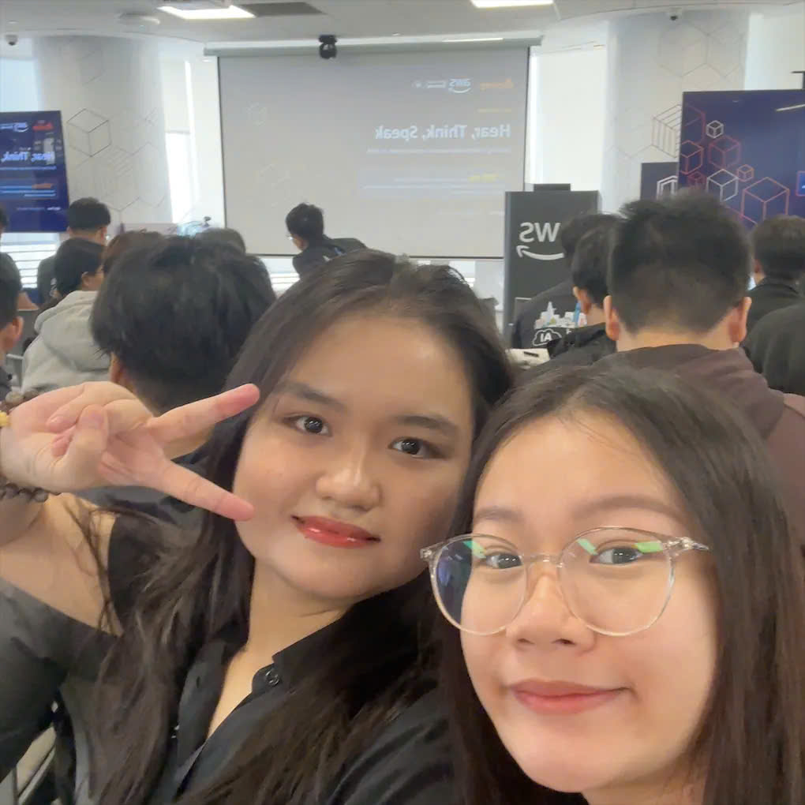
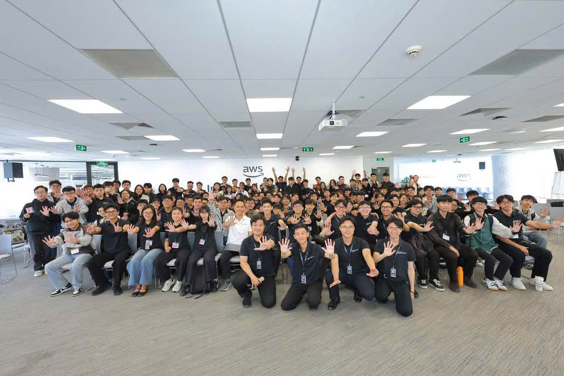

# First Cloud AI Journey – Weekly Meet Up

- **Thời gian:** 09:00 – 12:00, Thứ Bảy, ngày 24/10/2026
- **Địa điểm:** Tầng 26, Bitexco Financial Tower, TP. Hồ Chí Minh
- **Đơn vị tổ chức:** First Cloud AI Journey (FCAJ)
- **Vai trò:** Người tham dự trực tiếp

### Mục Đích Của Sự Kiện

First Cloud AI Journey – Weekly Meet Up là buổi gặp gỡ và chia sẻ kiến thức dành cho những người quan tâm đến AWS, Cloud Computing và trí tuệ nhân tạo (AI).

Chương trình tập trung vào cách ứng dụng AI trong thực tế, từ xây dựng hệ thống Voice AI, quản lý tài nguyên AWS đến kiểm thử bảo mật và sử dụng AI Agent để hỗ trợ công việc lập trình.

### Danh Sách Diễn Giả

- **Kiệt Trần** – Revve AI
- **Long Huỳnh** – Styl Solution
- **Thịnh Nguyễn** – Styl Solution
- **Xuân An** – AWS Student Builder Group HCMUTE
- **Khoa Kiều** – Tech Lead, ACB
- **Nghi Danh** – AWS Community Builder

### Nội Dung Nổi Bật

#### 1. Xây Dựng Tổng Đài Voice AI Tiếng Việt

Diễn giả giới thiệu cách xây dựng hệ thống AI có thể nghe, hiểu và phản hồi bằng giọng nói thông qua ba bước **Hear – Think – Speak**.

Hai mô hình được đề cập gồm:

- **Speech-to-Speech:** Xử lý trực tiếp giọng nói đầu vào và đầu ra.
- **ASR–LLM–TTS:** Kết hợp nhận dạng giọng nói, mô hình ngôn ngữ lớn và chuyển văn bản thành giọng nói.

Phần em ấn tượng nhất là demo AI thực hiện cuộc gọi phỏng vấn sơ tuyển vị trí Cloud Engineer bằng tiếng Việt. Qua đó, em thấy được cách AI có thể hỗ trợ công việc tuyển dụng và hiểu thêm về tầm quan trọng của tốc độ phản hồi trong một cuộc hội thoại.

#### 2. Quản Lý Tài Nguyên Với AWS Resource Access Manager

Phiên chia sẻ giới thiệu cách quản lý và chia sẻ tài nguyên giữa nhiều tài khoản AWS thông qua **AWS Organizations** và **AWS Resource Access Manager (RAM)**.

Một số nội dung chính:

- **AWS RAM:** Chia sẻ tài nguyên giữa các tài khoản AWS.
- **VPC và Subnet Sharing:** Cho phép nhiều tài khoản sử dụng chung tài nguyên mạng.
- **IAM Policies:** Quản lý quyền truy cập của người dùng và các vai trò.
- **Service Control Policies (SCP):** Giới hạn quyền trong môi trường nhiều tài khoản.

Qua phần này, em hiểu thêm cách doanh nghiệp tổ chức hệ thống Cloud để các nhóm có thể sử dụng chung tài nguyên mà vẫn đảm bảo việc phân quyền và quản lý.

#### 3. Ứng Dụng AI Trong Kiểm Thử Bảo Mật

Diễn giả giới thiệu **AWS Security Agent**, công cụ ứng dụng AI để hỗ trợ phát hiện và đánh giá các vấn đề bảo mật trong quá trình phát triển phần mềm.

Các nội dung đáng chú ý:

- Kiểm tra cấu hình hạ tầng được viết bằng Terraform.
- Phân tích mã nguồn để phát hiện những vấn đề bảo mật.
- Hỗ trợ review Pull Request trên GitHub và Merge Request trên GitLab.
- Đánh giá bảo mật tại môi trường SIT/UAT trước khi triển khai chính thức.

Phiên chia sẻ giúp em hiểu rõ hơn về việc tích hợp kiểm tra bảo mật ngay trong quá trình phát triển thay vì chỉ thực hiện khi sản phẩm đã hoàn thành.

#### 4. Amazon Bedrock AgentCore

Phiên này giới thiệu hai thành phần quan trọng trong việc xây dựng và vận hành AI Agent:

- **AgentCore Runtime:** Cung cấp môi trường thực thi cho AI Agent, sử dụng MicroVM để cô lập các phiên làm việc.
- **AgentCore Memory:** Quản lý thông tin và ngữ cảnh mà AI Agent cần ghi nhớ.

Trong đó, Memory được chia thành hai loại:

- **Short-term Memory:** Lưu trữ thông tin trong phiên tương tác hiện tại.
- **Long-term Memory:** Lưu giữ thông tin hữu ích để sử dụng trong những phiên tương tác sau.

Qua nội dung này, em hiểu thêm cách AI Agent duy trì ngữ cảnh, ghi nhớ thông tin và xử lý các tác vụ trong môi trường thực tế.

#### 5. Kiro Crew – AI Hỗ Trợ Công Việc Lập Trình

Đây là một trong những phiên em quan tâm nhất tại sự kiện. Diễn giả giới thiệu **Kiro Crew** và cách sử dụng AI để hỗ trợ một số công việc kỹ thuật.

Các nội dung chính:

- **Code Review:** Hỗ trợ kiểm tra và nhận xét những thay đổi trong mã nguồn.
- **Infrastructure Monitoring:** Hỗ trợ theo dõi tình trạng hệ thống.
- **Artifacts:** Tổng hợp dữ liệu và trình bày kết quả dưới dạng biểu đồ.
- **Context Window:** Quản lý lượng thông tin AI sử dụng trong một phiên làm việc.
- **Auto Compact:** Rút gọn lịch sử hội thoại để tiết kiệm ngữ cảnh.
- **Memory và Guardrails:** Quản lý thông tin được lưu trữ và giới hạn quyền của AI Agent.

Em ấn tượng với phần demo tổng hợp dữ liệu tuyển dụng thành biểu đồ và phần hỏi đáp về cách quản lý ngữ cảnh khi sử dụng AI trong thời gian dài.

### Những Gì Học Được

Sau buổi meetup, em có thêm kiến thức về những công nghệ đang được sử dụng trong các hệ thống Cloud và AI.

- **Voice AI:** Hiểu cách hệ thống tiếp nhận, xử lý và phản hồi thông tin bằng giọng nói.
- **AWS RAM:** Biết thêm cách chia sẻ tài nguyên giữa nhiều tài khoản AWS và kiểm soát quyền truy cập.
- **AWS Security Agent:** Hiểu cách AI hỗ trợ phát hiện những vấn đề bảo mật trong mã nguồn và hạ tầng.
- **Amazon Bedrock AgentCore:** Phân biệt vai trò của Runtime và Memory khi vận hành AI Agent.
- **Kiro Crew:** Tìm hiểu cách sử dụng AI để hỗ trợ review code, quản lý ngữ cảnh và tự động hóa công việc.

### Ứng Dụng Vào Công Việc

Từ những kiến thức tiếp thu được, em có thêm một số hướng để tìm hiểu và áp dụng vào quá trình học tập cũng như thực hiện dự án:

- Tìm hiểu sâu hơn về AWS IAM, Organizations và RAM để quản lý tài nguyên Cloud.
- Chú ý đến vấn đề bảo mật ngay từ giai đoạn phát triển phần mềm.
- Sử dụng các công cụ AI để hỗ trợ đọc code, tìm lỗi và kiểm tra những thay đổi trong dự án.
- Tìm hiểu cách quản lý Context Window và Memory để làm việc với AI Agent hiệu quả hơn.

### Trải Nghiệm Tại Sự Kiện

Buổi meetup là cơ hội để em được nghe các kỹ sư và Tech Lead chia sẻ kinh nghiệm thực tế khi làm việc với AWS và AI.

Hai phần khiến em ấn tượng nhất là demo cuộc gọi phỏng vấn bằng Voice AI và phần giới thiệu Kiro Crew. Những ví dụ này giúp em hình dung rõ hơn cách AI được sử dụng trong công việc thay vì chỉ tìm hiểu qua tài liệu.

Bên cạnh đó, phần hỏi đáp cũng mang lại nhiều thông tin hữu ích, đặc biệt là những vấn đề liên quan đến giới hạn của AI, quản lý ngữ cảnh và kiểm soát quyền truy cập khi triển khai AI Agent.

### Hình Ảnh Khi Tham Gia Sự Kiện

*Hình 1. Hình ảnh cá nhân tại First Cloud AI Journey – Weekly Meet Up ngày 24/10/2026.*

*Hình 2. Ảnh lưu niệm cùng các diễn giả và người tham dự sự kiện.*

